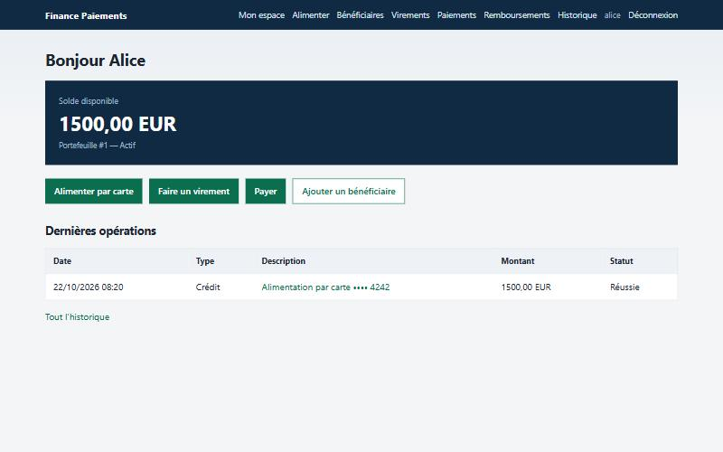
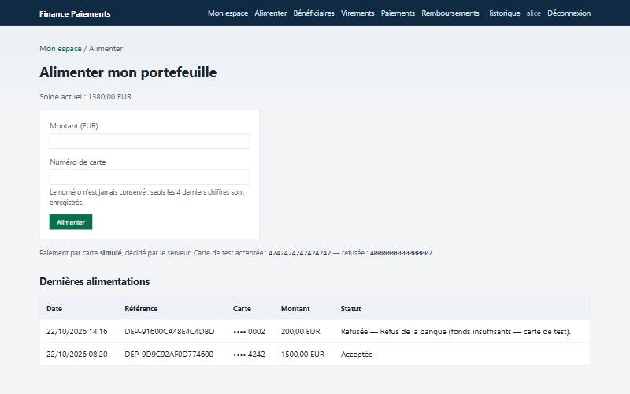
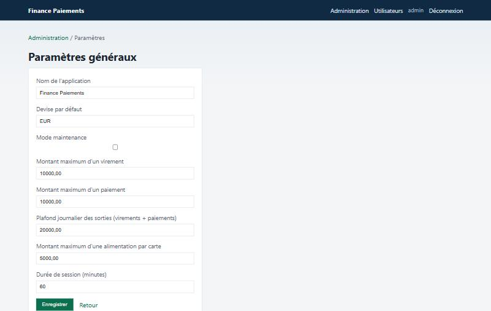

# Finance Paiements — portefeuille électronique et paiements numériques

[](https://github.com/MediJr/finance-paiements/actions/workflows/ci.yml)


Plateforme de **portefeuille électronique** : chaque client dispose d'un
portefeuille en euros qu'il alimente par carte, avec lequel il vire de l'argent à
ses proches, paie des commerçants et reçoit des remboursements. Le personnel
supervise, fixe les plafonds, peut suspendre les opérations, consulte journaux,
statistiques et exports. Interface web **et** API REST.

Conçue *Security by Design* et développée selon le modèle par **prototypage
évolutif** et la méthode **Scrum** (5 prototypes, 12 sprints), puis **auditée et
durcie** : 11 défauts corrigés, chacun couvert par des tests.

> 📄 **[Rapport de projet complet (PDF, 29 pages)](docs/rapport/Rapport-Finance-Paiements.pdf)** —
> analyse des besoins, conception, réalisation, tests, audit de sécurité et
> déploiement : tout le cycle de vie du développement logiciel.

| | |
|---|---|
| **Auteur** | LUMU BAMANA MANASSE |
| **Période** | août 2026 → 22 octobre 2026 (version 1.1.0) |
| **Modèle / méthode** | Prototypage évolutif · Agile Scrum |
| **Stack** | Python 3.12 · Django 6 · Django REST Framework · PostgreSQL 16 · Docker · GitHub Actions |

| Espace client | Alimentation par carte | Paramètres et plafonds |
|---------------|------------------------|------------------------|
|  |  |  |

## En 30 secondes

| Ce que montre le projet | Où le voir |
|-------------------------|------------|
| Un cycle de vie complet, de l'analyse au déploiement | [Rapport PDF](docs/rapport/Rapport-Finance-Paiements.pdf) · [cycle de vie](docs/cycle-de-vie.md) |
| Des exigences tracées jusqu'aux tests | [Cahier des charges](docs/cahier-des-charges.md) · [matrice de traçabilité](docs/tests.md#5-matrice-de-traçabilité) |
| Des mouvements de fonds fiables (atomicité, verrous, idempotence) | [Architecture](docs/architecture.md#4-flux-dun-virement) |
| Un audit de sécurité de mon propre code, avec corrections testées | [Sécurité](docs/securite.md) |
| Une application exécutable en 5 minutes | [Démarrage rapide](#démarrage-rapide-sans-docker) · [guide de démonstration](docs/guide-demo.md) |

## Fonctionnalités

**Client**
- Inscription, connexion (protégée contre la force brute), espace client avec solde et dernières opérations
- Alimentation du portefeuille par carte (passerelle simulée côté serveur)
- Bénéficiaires (ajout par e-mail), virements, paiements, remboursements totaux ou partiels
- Historique complet et filtrable

**Administrateur**
- Supervision des utilisateurs, portefeuilles et opérations ; activation / désactivation des comptes
- Paramètres : plafond par opération, plafond journalier, plafond d'alimentation, mode maintenance, durée de session
- Journal des actions d'administration, journal d'événements, tableau de bord, statistiques, rapports
- Exports CSV / JSON

## Points techniques

| Sujet | Mise en œuvre |
|-------|---------------|
| Intégrité des fonds | Un **seul module** débite / crédite : transaction atomique, verrous de ligne dans un ordre stable, solde vérifié après verrouillage |
| Idempotence | Clé unique par opération (champ caché, en-tête `Idempotency-Key`) : un double clic ne débite jamais deux fois |
| Conformité | Plafond par opération et plafond journalier cumulé, mode maintenance |
| Confidentialité | Cloisonnement par propriétaire, annuaire non énumérable, numéro de carte jamais conservé |
| Sécurité | CSRF, blocage des connexions, redirections sûres, injection CSV neutralisée, HTTPS en production |
| Qualité | 169 tests, 86 % de couverture, CI sur SQLite **et** PostgreSQL |

## Démarrage rapide (sans Docker)

```bash
python -m venv .venv
.venv\Scripts\activate                     # Linux / macOS : source .venv/bin/activate
pip install -r requirements-dev.txt
set DJANGO_SETTINGS_MODULE=config.settings.local   # Linux / macOS : export ...
python backend/manage.py migrate
python backend/manage.py creer_comptes_demo
python backend/manage.py runserver 8001
```

Ouvrir http://127.0.0.1:8001/ — comptes : `alice` / `Alice-Demo-2026` (1 500 EUR),
`bob` / `Bob-Demo-2026`, `admin` / `Admin-Demo-2026`.

Cartes de test : `4242 4242 4242 4242` (acceptée), `4000 0000 0000 0002` (refusée).

Docker, production et variables d'environnement : [docs/installation.md](docs/installation.md).

## Tests

```bash
pytest                                     # 169 tests
pytest tests/test_durcissement.py          # audit de sécurité du sprint 11
pytest --cov                               # couverture
pytest --ds=config.settings.test_postgres  # sur PostgreSQL
```

## Documentation

| Phase | Document |
|-------|----------|
| Méthode | [Cycle de vie : prototypage évolutif + Scrum](docs/cycle-de-vie.md) |
| Analyse | [Cahier des charges](docs/cahier-des-charges.md) · [Backlog](docs/backlog.md) |
| Conception | [Architecture et modèle de données](docs/architecture.md) |
| Tests | [Stratégie et matrice de traçabilité](docs/tests.md) |
| Audit | [Sécurité et défauts corrigés](docs/securite.md) · [Security by Design](docs/security-by-design.md) |
| Déploiement | [Installation](docs/installation.md) |
| Démonstration | [Guide de démonstration](docs/guide-demo.md) |
| Suivi | [Changelog](CHANGELOG.md) · [Rapports de sprint](livrables/README.md) · [Index complet](docs/README.md) · [API](api/README.md) |

## Structure

```text
backend/          Projet Django (settings par environnement, manage.py)
accounts/         Utilisateurs, inscription, connexion, espace client
wallets/          Portefeuilles, mouvements de fonds, alimentation par carte
historique/       Historique des opérations
beneficiaires/    Bénéficiaires
virements/        Virements
paiements/        Paiements et remboursements
administration/   Paramètres, supervision, pilotage, exports
observabilite/    Journal d'événements
api/              API REST
commun/           Utilitaires transverses (IP, redirections, idempotence)
frontend/         Gabarits et CSS
tests/            Tests pytest
docker/           Dockerfile, Compose développement et production
docs/             Documentation et rapport LaTeX
livrables/        Rapports de sprint et audits
```

## Évolutions possibles

- Double authentification pour les opérations sensibles
- Prestataire de paiement réel en mode test (même interface que la passerelle simulée)
- Retrait vers un compte bancaire (SEPA)
- Redis pour le cache en déploiement multi-instance

## Licence

[MIT](LICENSE)
