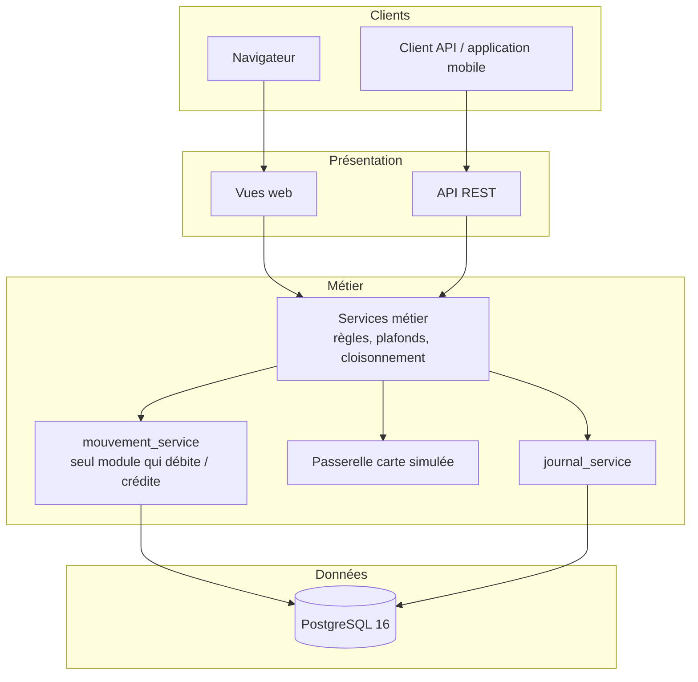
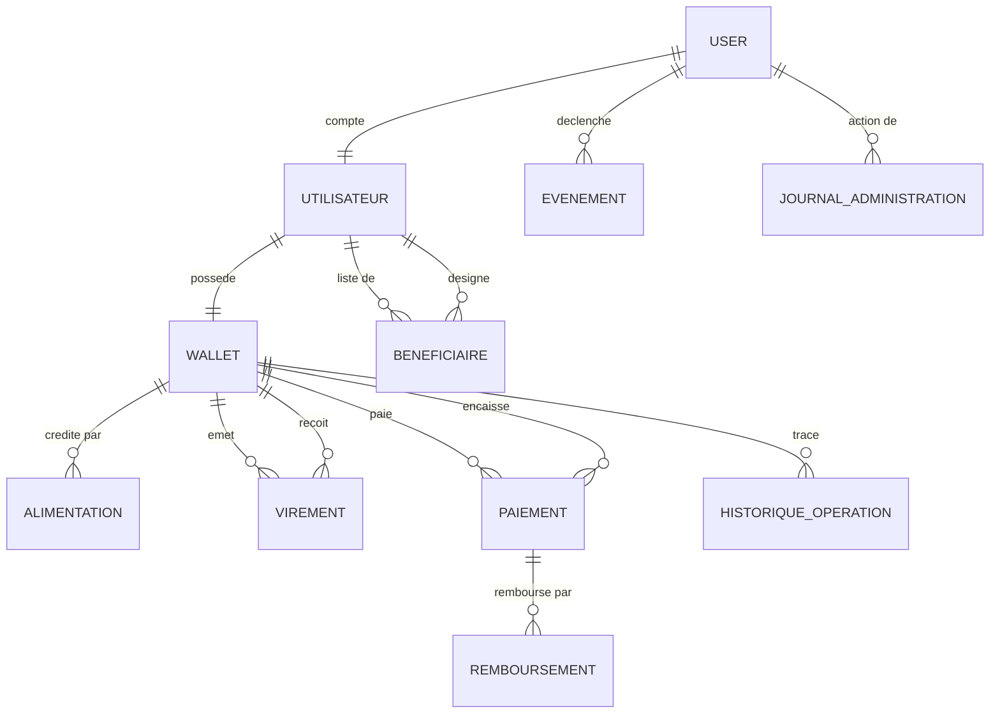
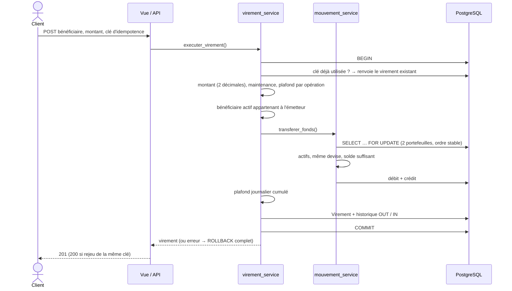

# Architecture et conception

> Phase du cycle de vie : **Conception**.

## 1. Vue d'ensemble

Application web **Django** monolithique et modulaire : une interface web
(gabarits serveur) et une **API REST** (Django REST Framework) partagent la même
couche de services métier.



### Règle d'architecture en couches

| Couche | Responsabilité | Interdit |
|--------|----------------|----------|
| Vues web / API | Lire la requête, appeler un service, rendre la réponse | Logique métier, accès direct au solde |
| Services | Règles métier, plafonds, maintenance, cloisonnement par propriétaire, transactions, journalisation | Dépendre du format de la requête |
| `mouvement_service` | **Seul** point de débit / crédit entre portefeuilles (verrous, contrôle du solde, historique) | — |
| Modèles | Structure des données, contraintes d'unicité | Logique de workflow |

## 2. Modules

| Module | Rôle |
|--------|------|
| `accounts` | Utilisateurs métier, inscription, connexion protégée, espace client |
| `wallets` | Portefeuilles, mouvements de fonds, alimentation par carte (passerelle simulée) |
| `historique` | Journal des opérations de chaque portefeuille |
| `beneficiaires` | Destinataires autorisés (ajout par e-mail) |
| `virements` | Virements entre portefeuilles |
| `paiements` | Paiements et remboursements |
| `administration` | Paramètres, supervision, sécurité, pilotage, exports |
| `observabilite` | Journal d'événements immuable, erreurs HTTP 500 |
| `api` | Routes REST (client et administration) |
| `commun` | Utilitaires transverses : adresse IP fiable, redirections sûres, clé d'idempotence |

## 3. Modèle de données

11 modèles :



`ParametresApplication` est un singleton (plafonds, devise, maintenance, durée de session).

Choix de conception notables :

- **Solde jamais négatif** : contrôle du solde *après* verrouillage des deux
  portefeuilles, dans la même transaction que l'écriture.
- **Verrous dans un ordre stable** (identifiants triés) pour éviter les interblocages
  entre deux virements croisés.
- **Idempotence** : `Virement`, `Paiement` et `Alimentation` portent une
  `cle_idempotence` unique par portefeuille émetteur (contrainte en base).
- **Historique double** : chaque transfert écrit une ligne `-OUT` côté émetteur et
  une ligne `-IN` côté destinataire.
- **Montants décimaux** : `Decimal` à 2 décimales, jamais de flottant.

## 4. Flux d'un virement



Si **n'importe quelle** vérification échoue, la transaction entière est annulée :
aucun débit sans crédit, aucun virement sans historique.

## 5. Alimentation par carte

```text
Client ── montant + numéro de carte ──▶ alimentation_service
            verrou du portefeuille · clé d'idempotence · plafond d'alimentation
            passerelle_carte.autoriser_carte()  (Luhn ; refus si fin « 0002 »)
                 ├─ acceptée → solde += montant, historique CREDIT « réussie »
                 └─ refusée  → solde inchangé,   historique CREDIT « échouée »
            Alimentation enregistrée avec « •••• 4242 » uniquement
```

## 6. Sécurité transverse

| Mécanisme | Où |
|-----------|-----|
| Cloisonnement par propriétaire | Chaque service reçoit l'utilisateur connecté et filtre dessus |
| Administration | `administrateur_required` (web), `IsAdministrateur` (API) |
| Maintenance | Contrôle dans les services + filet HTTP (`SecurityParametresMiddleware`) |
| Durée de session | Paramètre appliqué par middleware |
| Journal | `journal_service` (unique point d'écriture des événements) |

Détails : [securite.md](securite.md), [security-by-design.md](security-by-design.md).

## 7. Configuration par environnement

| Module de configuration | Usage |
|-------------------------|-------|
| `config.settings.development` (défaut) | Développement avec PostgreSQL, `DEBUG=True` |
| `config.settings.local` | Démarrage rapide avec SQLite |
| `config.settings.test` | Tests (SQLite en mémoire) |
| `config.settings.test_postgres` | Suite de tests sur PostgreSQL |
| `config.settings.production` | Production : HTTPS, cookies sécurisés, HSTS, WhiteNoise, clé secrète obligatoire |
