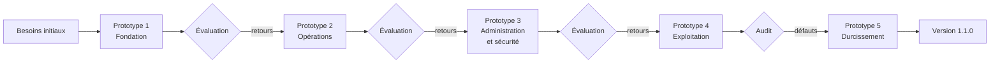

# Cycle de vie du développement

Ce document décrit **comment** le logiciel a été construit : le modèle de cycle
de vie retenu, la méthode de travail, les phases et les livrables associés.

## 1. Modèle : prototypage évolutif

Le projet suit le **modèle par prototypage évolutif** : le logiciel est
construit sous forme de prototypes successifs. Chaque prototype est
**fonctionnel**, testé et utilisable ; il n'est pas jeté mais **enrichi** par le
suivant, jusqu'au produit final.

**Pourquoi ce modèle ?**

| Critère | Justification |
|---------|---------------|
| Besoins qui se précisent en cours de route | Un portefeuille électronique se comprend en le manipulant : l'impossibilité d'approvisionner un portefeuille n'est apparue qu'en jouant le parcours complet du prototype 4. |
| Risques maîtrisés tôt | Le cœur sensible (mouvements de fonds atomiques) est construit et testé dès le prototype 2, avant toute interface d'administration. |
| Sécurité par couches | Le prototype 3 est consacré à la *Security by Design* ; le prototype 5 à l'audit et au durcissement. |
| Développeur unique | Pas de lourdeur documentaire initiale : la documentation grandit avec le produit. |

## 2. Méthode : Agile / Scrum adapté

À l'intérieur de chaque prototype, le travail est découpé en **sprints** courts
selon la méthode **Scrum**, adaptée à un développeur seul :

| Élément Scrum | Mise en œuvre dans ce projet |
|---------------|------------------------------|
| Product Owner | Moi-même : je définis et priorise le backlog. |
| Équipe de développement | Moi-même. |
| Client / parties prenantes | Moi-même, dans le rôle d'utilisateur final : chaque prototype est évalué en le manipulant comme client puis comme administrateur. |
| Product backlog | [backlog.md](backlog.md) — récits utilisateurs priorisés (MoSCoW). |
| Sprint planning | Objectif de sprint + récits sélectionnés (en-tête de chaque rapport de sprint). |
| Incrément | Code + migrations + tests + documentation, livrés ensemble. |
| Sprint review | Démonstration du parcours et validation de l'objectif. |
| Rétrospective | Section « Limites / suite » des rapports de sprint ; points repris dans le sprint suivant. |

### Definition of Done

Un récit utilisateur est **terminé** lorsque :

1. le code est écrit dans la couche adaptée (service métier, puis vue / API) ;
2. toute modification de solde passe par `mouvement_service` (ou le service d'alimentation) ;
3. les migrations sont générées et `makemigrations --check` ne détecte rien ;
4. des tests automatisés couvrent le cas nominal **et** les cas d'erreur ;
5. la suite complète passe (`pytest`) ;
6. les actions sensibles sont journalisées (à partir du sprint 9) ;
7. la documentation du module et le rapport de sprint sont à jour.

## 3. Phases du cycle de vie et livrables

| Phase | Contenu | Livrables dans le dépôt |
|-------|---------|-------------------------|
| 1. Analyse des besoins | Contexte, acteurs, exigences fonctionnelles et non fonctionnelles | [cahier-des-charges.md](cahier-des-charges.md), [backlog.md](backlog.md) |
| 2. Conception | Architecture en couches, modèle de données, flux de fonds | [architecture.md](architecture.md), docs des modules |
| 3. Réalisation | Développement incrémental par sprints | Code source, [rapports de sprint](../livrables/README.md) |
| 4. Tests | Unitaires, intégration, sécurité ; intégration continue | [tests.md](tests.md), `tests/`, `.github/workflows/ci.yml` |
| 5. Audit / validation | Audit technique, audit de sécurité, remédiation | [securite.md](securite.md), `livrables/Audit/` |
| 6. Déploiement | Docker, configuration de production | [installation.md](installation.md), `docker/` |
| 7. Maintenance | Journal des modifications, versions | [CHANGELOG](../CHANGELOG.md), [versions.md](versions.md) |

## 4. Déroulé : prototypes et sprints

| Prototype | Sprint | Objectif du sprint | Résultat |
|-----------|:------:|--------------------|----------|
| **1 — Fondation** | 0 | Initialiser le projet | Django, DRF, PostgreSQL, Docker, tests de configuration |
| | 1 | Utilisateurs et portefeuilles | Portefeuille créé automatiquement, solde initial nul |
| | 2 | Historique des opérations | Journal d'opérations par portefeuille, filtres |
| **2 — Opérations** | 3 | Bénéficiaires | Liste de destinataires autorisés, désactivation logique |
| | 4 | Virements | Débit / crédit atomiques, verrous de ligne, historique automatique |
| | 5 | Paiements et remboursements | Remboursement total ou partiel, factorisation des mouvements de fonds |
| **3 — Administration et sécurité** | 6 | Administration | Paramètres, supervision, activation des comptes |
| | 7 | Security by Design | Cloisonnement par propriétaire, plafonds, maintenance, journal d'administration |
| | 8 | Pilotage | Tableau de bord, statistiques, rapports |
| **4 — Exploitation** | 9 | Observabilité | Journal d'événements immuable, erreurs 500 tracées |
| | 10 | Exports | CSV / JSON, 8 jeux de données |
| **5 — Durcissement** | 11 | Audit et remédiation | 11 défauts corrigés, espace client, alimentation par carte, 48 tests ajoutés, CI, production |

### Retours ayant fait évoluer le produit

| Constat (évaluation) | Prototype | Évolution apportée |
|----------------------|:---------:|--------------------|
| L'API exposait encore les profils et portefeuilles des autres clients (audit du sprint 6) | 3 | Cloisonnement par propriétaire (sprint 7) |
| Les plafonds et la maintenance étaient configurables mais pas appliqués (audit du sprint 6) | 3 | Application réelle dans les services (sprint 7) |
| Un client ne pouvait ni se connecter (seul `/admin/` existait) ni approvisionner son portefeuille | 4 | Espace client et alimentation par carte (sprint 11) |
| Un double clic pouvait débiter deux fois ; le plafond par opération se contournait en plusieurs fois | 4 | Clés d'idempotence et plafond journalier (sprint 11) |

## 5. Gestion de version

- Dépôt Git, branche principale `main`.
- Messages de commit conventionnels (`feat`, `fix`, `docs`, `test`, `chore`).
- Versionnement sémantique : `MAJEUR.MINEUR.CORRECTIF` (voir [CHANGELOG](../CHANGELOG.md)).
- Intégration continue GitHub Actions : tests, couverture, migrations,
  `check --deploy`, suite complète sur PostgreSQL.
